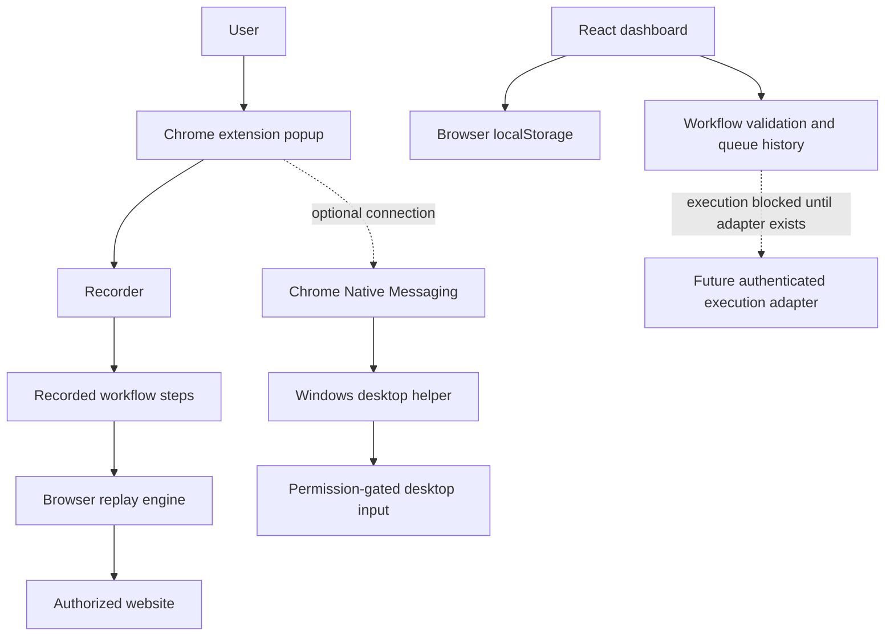

<!--
  SatyTracker78 — project documentation
  Created by Satyendra Kumar Namdeo.
  Copyright (c) 2026 Satyendra Kumar Namdeo. All rights reserved.
-->

<div align="center">

# SatyTracker78

### Record once. Review the flow. Repeat with control.

**A local-first workflow toolkit for authorized browser automation, with an optional Windows desktop companion and a workflow-management dashboard.**

[](https://github.com/SanFlash/satyenstg1/actions/workflows/ci.yml)
[](https://developer.chrome.com/docs/extensions/develop)
[](https://github.com/SanFlash/satyenstg1/releases/tag/desktop-helper-latest)
[](https://react.dev/)
[](https://www.typescriptlang.org/)

[Quick start](#-quick-start) · [Features](#-what-the-product-includes) · [Installation](#-installation-guides) · [How it works](#-how-it-works) · [Security](#-privacy-and-security) · [Troubleshooting](#-troubleshooting)

</div>

---

## Product overview

SatyTracker78 is organized into three related parts:

| Part | Purpose | Current role |
|---|---|---|
| **Chrome extension** | Capture supported interactions on a website and replay the recorded sequence | Working browser record-and-repeat experience |
| **Windows Desktop Helper** | Provide a separately installed, permission-gated Native Messaging companion for explicit desktop input | Optional Windows x64 companion; requires local user approval |
| **Workflow dashboard** | Create, edit, validate, import/export and review structured workflow definitions and run records | Local browser-based management UI; execution is safely blocked until a real authenticated execution adapter is connected |

The dashboard currently uses the **MouseFlow AI** product label in parts of its interface and page metadata. It is part of this repository's workflow-management experience; the Chrome extension is branded **SatyTracker78 — Record & Repeat**.

> **Important distinction:** the extension's browser replay and the dashboard's workflow queue are separate execution paths. The dashboard currently records a blocked queue attempt rather than executing actions. A visual connection state in the dashboard is demonstrative and is not proof that a live extension or desktop agent has paired.

## Animated product walkthrough

The diagrams below are designed as moving explainers: follow the animated signal to understand which component receives an action, what it does next, and where the boundaries are. They illustrate the architecture and workflow; they are not recordings of a live user session.

### 1. Product architecture — three separate paths

<p align="center">
  
</p>

**How to read the flow**

- **Lane A — Browser workflow:** user interactions are captured by the extension recorder, converted into contextual steps, resolved again during replay, and dispatched as synthetic page-level events to the active website. The loop continues until the user stops it.
- **Lane B — Windows companion:** the user installs a local Native Messaging host, Chrome communicates with it, and a Windows permission dialog gates desktop input. Approval is time-limited. This is a separate optional component, not a claim that every browser replay action is sent through the operating-system input layer.
- **Lane C — Dashboard:** workflow definitions are created and edited in the React UI, validated and saved in browser local storage. A queue attempt is recorded as blocked until a real authenticated execution adapter exists.

### 2. What a replay cycle looks like

<p align="center">
  
</p>

**Replay sequence explained**

1. **Resolve:** the content script attempts the recorded selector and checks the element against its saved text, role, label and surrounding context.
2. **Wait when needed:** replay can wait for a target to appear rather than immediately failing on a page that is still rendering.
3. **Move:** the in-page pointer animates toward the resolved target using eased movement.
4. **Act:** the extension dispatches the supported synthetic page interaction.
5. **Pause:** the configured action delay gives the page time to respond.
6. **Repeat:** after the final step, the configured loop delay is applied before the next cycle.
7. **Stop:** the user can stop replay from the extension popup. If stop-on-error is enabled, an unreplayable action ends the sequence.

### 3. The basic user journey

| Stage | User does | Product response |
|---|---|---|
| Prepare | Opens an authorized website | Extension popup is ready |
| Record | Starts recording and performs a task | Supported DOM actions and target context are captured |
| Review | Finishes recording and checks the step count | Recorded sequence is available for replay |
| Configure | Sets action delay, loop delay and stop-on-error | Replay behavior is configured |
| Replay | Starts repeating the flow | Steps are resolved and dispatched in order |
| Control | Stops replay when finished or when something looks wrong | The loop stops |

> **Important:** the animated diagrams explain the product's current architecture. The dashboard lane is deliberately shown as a blocked queue path, not as a working execution engine. The Windows companion is optional and has its own permission gate.

---

## ✨ What the product includes

### 1. Chrome extension — Record & Repeat

The extension is a Chrome Manifest V3 extension located in [`extension/`](extension/).

- Records supported browser DOM interactions.
- Captures interaction context such as visible text, accessible role, labels, attributes, nearby text, normalized position and a best-effort selector.
- Replays a recorded sequence repeatedly until the user stops it.
- Offers configurable delay between actions and between complete loops.
- Includes a **Stop if an action cannot be replayed** option.
- Shows recorded-step and loop-iteration counters.
- Uses a selector-first matching strategy, then semantic/context matching, followed by a position fallback.
- Animates a small in-page pointer during replay, including movement, hover and click feedback.
- Does not require Chrome DevTools debugger attachment and does not add a floating control panel to the target page.

**Interaction and compatibility notes**

The extension records DOM actions, not a screen-video recording. It uses synthetic page-level pointer and mouse events coordinated with its animated page cursor. These are not trusted hardware events and do not move the operating-system cursor. Some websites reject synthetic events or require trusted physical input. Protected pages, canvas-based interfaces, cross-origin frames and highly dynamic applications may need specialized support.

Sensitive password, file-upload, payment-card and one-time-code fields are excluded. Review every workflow before replaying it.

### 2. Optional Windows Desktop Helper

The desktop companion lives in [`desktop-agent/`](desktop-agent/). The supported packaged helper is a self-contained **.NET 8, Windows x64** executable registered as a Chrome Native Messaging host.

- Designed for Windows 10/11 x64.
- Installs for the current Windows user.
- Registers the Native Messaging host for the exact extension ID supplied during setup.
- Does not require a separate .NET SDK, Python, pip, administrator access or manual registry editing for the packaged end-user installation.
- Requests local permission before desktop input is enabled.
- Permission expires after five minutes; Stop or Chrome disconnect revokes the session.
- Includes guided install, uninstall and diagnostic scripts.

The companion is optional. The browser extension's recording and browser replay features do not require it.

**Current boundary:** the presence of the helper does not mean every browser replay step is routed through trusted operating-system input. The native companion and browser replay are separate components; do not assume end-to-end desktop replay integration or compatibility with every protected website.

### 3. Workflow dashboard

The Vite + React + TypeScript dashboard is the repository's workflow-management interface.

Current UI capabilities include:

- Overview of saved workflows and locally recorded run history.
- Create, rename, edit and delete workflow definitions.
- Configure browser or desktop environment labels.
- Add workflow steps and choose action types such as click, double-click, hover, scroll, wait and verify.
- Configure locator strategies including CSS, XPath, ID, text, role and test ID.
- Configure timeout, retry, repeat count, delay and stop-on-error values.
- Import workflow JSON with schema validation and a 1 MB file-size limit.
- Export workflow definitions and execution history as JSON.
- Store workflow definitions and history in the current browser's local storage.

**Execution status:** the hosted dashboard does not currently execute browser or desktop actions. When a user attempts to queue a workflow, it validates required locator data and records a safely blocked history entry explaining that no authenticated local execution adapter is connected. Connection toggles are demo UI state, not a live pairing protocol. The dashboard must not be described as a production execution engine until a real adapter and authenticated pairing flow are implemented and tested.

---

## ⚡ Quick start

### Use the Chrome extension (browser workflow)

1. Download or clone this repository.
2. Open Google Chrome and navigate to `chrome://extensions`.
3. Enable **Developer mode**.
4. Select **Load unpacked**.
5. Choose the repository's `extension` directory.
6. Open a normal `http://` or `https://` website that you are authorized to operate.
7. Open the SatyTracker78 toolbar popup and select **Start recording**.
8. Perform the task, reopen the popup and select **Finish recording**.
9. Set **Flow speed** and **Delay between loops**.
10. Select **Start repeating flow**. Reopen the popup and select **Stop replay** to end it.

For the optional Windows companion, follow the [Windows installation guide](#windows-desktop-helper-windows-1011-x64).

---

## 📦 Installation guides

### Chrome extension — developer / unpacked installation

**Requirements**
- Google Chrome.
- A local copy of this repository.
- Permission to load an unpacked extension.

**Steps**
1. Clone the repository:
   ```bash
   git clone https://github.com/SanFlash/satyenstg1.git
   cd satyenstg1
   ```
2. Open `chrome://extensions`.
3. Turn on **Developer mode**.
4. Click **Load unpacked** and select the `extension/` folder.
5. Pin SatyTracker78 to the Chrome toolbar for convenient access.
6. After pulling updates, return to `chrome://extensions` and click **Reload** on the extension.

More extension-specific instructions: [extension/README.md](extension/README.md).

### Windows Desktop Helper (Windows 10/11 x64)

<details>
<summary><strong>Expand the one-time Windows setup guide</strong></summary>

**Requirements**
- Windows 10 or Windows 11, 64-bit.
- Google Chrome with SatyTracker78 already loaded.
- Permission to run an application for your Windows user account.

**Step 1 — Download the installer**

Download the latest published package:

[**Download SatyTracker78-Windows-Setup.zip**](https://github.com/SanFlash/satyenstg1/releases/download/desktop-helper-latest/SatyTracker78-Windows-Setup.zip)

[View the latest desktop-helper release](https://github.com/SanFlash/satyenstg1/releases/tag/desktop-helper-latest).

If the release asset is not available, check the [GitHub Actions runs](https://github.com/SanFlash/satyenstg1/actions) for the latest successful Windows build. Do not assume a package exists until the workflow has completed successfully and published it.

**Step 2 — Extract the ZIP**

Extract the entire ZIP to a normal folder. Do not launch setup from inside the compressed-folder preview.

**Step 3 — Run the guided installer**

Double-click:

```text
Setup-SatyTracker78.cmd
```

**Step 4 — Copy the Chrome extension ID**

1. Open `chrome://extensions`.
2. Find SatyTracker78.
3. Copy its **ID**.
4. Paste the exact ID into the installer when prompted.

The Native Messaging registration is restricted to the extension ID entered during installation.

**Step 5 — Restart Chrome**

Fully exit all Chrome windows and reopen Chrome. Reload SatyTracker78 from `chrome://extensions`.

**Step 6 — Approve desktop permission**

1. Open the extension popup.
2. Select **Connect & enable desktop helper**.
3. Read the local Windows permission dialog.
4. Approve only when you intend to allow the requested visible desktop input.

Desktop access remains disabled until the local prompt is approved. Permission is time-limited to five minutes.

**Uninstall**

Run `Uninstall-SatyTracker78.cmd` from the extracted setup folder. The uninstaller removes the current user's Native Messaging registration and the installed SatyTracker78 helper folder.

**Repair / diagnostics**
- Re-run `Setup-SatyTracker78.cmd` to repair registration.
- Confirm the extension ID matches the ID in Chrome.
- Fully restart Chrome after setup or repair.
- Run `diagnose-agent.ps1` if the diagnostic script is present in the developer/source folder.
- Review the local log at `%LOCALAPPDATA%\SatyTracker78\native-host.log`.

No separate .NET SDK, Python, pip, administrator access or manual registry editing is intended to be required for the packaged end-user installer.

</details>

### Dashboard — local development

**Requirements**
- Node.js 22 (the CI workflow uses Node 22).
- npm.

Install dependencies and start the Vite development server:

```bash
npm install
npm run dev
```

Vite prints the local development URL in the terminal. Open that URL in your browser.

---

## 🎛️ Using the browser recorder

### Record a workflow

1. Navigate to the target page.
2. Open the extension popup.
3. Select **Start recording**.
4. Perform the intended browser interactions.
5. Select **Finish recording**.

The extension records supported DOM interactions and contextual information to help locate targets again during replay.

### Configure replay

| Setting | Purpose |
|---|---|
| **Flow speed** | Delay between individual replay actions |
| **Delay between loops** | Pause after one complete sequence before the next cycle |
| **Stop if an action cannot be replayed** | Ends replay when a step cannot be completed |
| **Start repeating flow** | Starts the recorded sequence |
| **Stop replay** | Stops the active replay loop |

Start with a conservative delay and a short test workflow. Validate the result on a non-critical page before using a workflow in a real process.

### Understand locator matching

A recorded action stores a best-effort selector together with semantic and positional context. During replay, the extension attempts to resolve the target using its available matching strategies. If a website has changed significantly since recording, the target may no longer match.

A successful selector match is not a guarantee that the resulting action is appropriate. Always review the target page and the workflow's effects.

---

## 🔬 Browser recorder and replay — detailed behavior

This section describes what is actually captured and how the extension tries to find the same target later.

### What can be captured

| Interaction | Recording behavior |
|---|---|
| Click | Captures supported buttons, links, menu items, tabs, options and related interactive roles |
| Text entry | Captures supported text/search/email/url/tel/number inputs, textareas and editable content after a short settle period |
| Select / checkbox / radio | Captures supported value or checked-state changes |
| Scroll | Captures a settled document scroll position rather than every scroll frame |
| Page navigation | Step context includes the page URL so replay can reason about the recorded location |

The recorder stores useful target context such as selector, tag, role, visible text, label, accessible label, title, name, placeholder, test ID, nearby parent text, grandparent text and normalized position. Input values are bounded in length. Sensitive field types are intentionally excluded.

### How target resolution works

The content script uses a best-effort strategy rather than trusting one brittle selector:

1. Try the recorded selector.
2. Check that the candidate is visible, connected to the page and not marked private.
3. Score candidate elements using role, text, label, attributes, link destination and nearby context.
4. Prefer a sufficiently strong or unambiguous match.
5. If necessary, use the recorded normalized position to find a safe interactive element under that point.
6. If no suitable target appears within the wait window, report a target-not-found error.

This approach improves resilience to modest page changes, but it cannot guarantee success after major redesigns, dynamic content changes or ambiguous duplicate controls.

### Replay motion and event model

The page-only cursor is an explanatory visual aid. Its movement is animated within the webpage and can include eased travel, hover transitions and click feedback. The cursor does not represent the physical Windows pointer. Clicks are synthetic page events, not trusted hardware events. Websites that require trusted input may reject them.

### Timing controls

- **Flow speed:** delay between replay actions.
- **Delay between loops:** pause after one full sequence and before the next cycle.
- **Stop on error:** stops the sequence when a step cannot be replayed, rather than continuing blindly.

Start with a short flow and a conservative delay. A page's response time can vary by network, rendering, authentication state and application behavior.

---

## 🧭 How it works

### Component architecture



### Repository structure

```text
satyenstg1/
├── .github/
│   └── workflows/
│       └── ci.yml                 # Linux checks + Windows agent build/package
├── desktop-agent/
│   ├── SatyTracker78.Agent.csproj
│   ├── Program.cs                 # .NET Native Messaging desktop companion
│   ├── Setup-SatyTracker78.cmd    # End-user setup launcher
│   ├── Install-SatyTracker78.ps1  # Per-user installation and registration
│   ├── Uninstall-SatyTracker78.cmd
│   ├── Uninstall-SatyTracker78.ps1
│   ├── test_protocol.py
│   └── README.md
├── docs/
│   ├── ARCHITECTURE.md
│   ├── DEPLOYMENT.md
│   ├── SECURITY.md
│   ├── tracker-integrations.md
│   └── assets/
│       └── workflow-lifecycle.svg
├── extension/
│   ├── manifest.json              # Manifest V3 configuration
│   ├── background.js              # Extension service worker
│   ├── recorder.js                # Browser interaction recording/replay
│   ├── popup.html
│   ├── popup.css
│   ├── popup.js
│   ├── setup.html                 # Optional desktop-helper setup guide
│   ├── setup.css
│   ├── setup.js
│   └── README.md
├── src/                           # React + TypeScript dashboard
├── tests/                         # End-to-end tests
├── package.json
├── playwright.config.ts
├── vite.config.ts
└── README.md
```

The tree above highlights the main product areas; individual test and support files may also exist in these directories.

### Data and execution boundaries

- Extension workflow data is handled by the extension's browser-side implementation.
- Dashboard workflows and run history are stored in that browser's local storage.
- The dashboard is a static client-side SPA; no backend database or server-side workflow executor is configured by the deployment guide.
- Native Messaging connects Chrome to a separately installed local Windows process.
- The desktop helper has its own local permission boundary and emergency stop behavior.
- The dashboard's queue records are not the same as successful browser or desktop executions.

---

## 🧩 Dashboard — workflow management details

The React dashboard is useful for designing and organizing structured workflow definitions. It is not currently wired to the Chrome recorder's execution engine.

### Workflow definition model

A workflow includes:
- Name and environment label (`browser` or `desktop`).
- Repeat count (bounded to 1–100).
- Delay between runs (bounded to 0–60,000 ms).
- Stop-on-error behavior.
- One or more ordered steps.

Each step includes a name, supported action, locator strategy and value, timeout (100–60,000 ms), and retry count (0–5). Supported action labels are click, double-click, hover, scroll, wait and verify. Supported locator strategies are CSS, XPath, ID, text, role and test ID.

### Import validation

Workflow JSON import is schema-checked before it is added to the library. The current UI limits import files to 1 MB; validation checks workflow name, environment, repeat count, delay, stop-on-error, step count, action names, locator strategy/value, role requirements, timeout and retry bounds. Invalid JSON or out-of-range values are rejected.

### Local persistence and export

- Workflow definitions are saved in browser `localStorage`.
- Run history is saved in browser `localStorage`.
- Workflow definitions can be exported as JSON.
- Run history can be exported as JSON.
- Storage is local to that browser profile; it does not synchronize automatically across devices or browsers.

### Why a queued dashboard run is blocked

The dashboard currently creates a history record with a `blocked` status and a message that no authenticated local execution adapter is connected. It does not invoke the extension replay engine or the Windows companion. Connection toggles are demonstrative UI state only. This boundary is intentional and is shown as such in the product architecture animation.

---

## 🔐 Privacy and security

SatyTracker78 is intended for transparent, user-authorized automation. Use it only on websites, accounts and devices where you have permission.

### Desktop permission model

- Desktop input starts disabled.
- A local Windows permission prompt must be approved before desktop input is enabled.
- Permission expires after five minutes.
- Stop or Chrome disconnect revokes the permission.
- The Native Messaging host validates the allowed extension origin and message contract.

### Data handling and exclusions

The product is designed not to include:
- Screenshot or screen-video capture.
- Clipboard capture.
- Hidden keystroke logging.
- Password, payment-card, file-upload or one-time-code field recording.
- Idle-time or productivity-signal spoofing.
- Monitoring or security-control evasion.
- CAPTCHA, access-control or authentication bypass.

Do not put passwords, cookies, API tokens or other secrets into workflow exports. Treat exported workflow JSON and diagnostic logs as user data and review them before sharing.

Read the detailed [security model](docs/SECURITY.md).

---

## 🔌 Tracker integrations — status and boundaries

SatyTracker78 has a documented research plan for provider-authorized, read-oriented integrations. It does **not** impersonate tracker clients, manipulate timers, spoof activity, or bypass employer policies.

| Provider | Research / API surface | SatyTracker78 implementation status |
|---|---|---|
| Upwork | GraphQL APIs and OAuth 2.0; API credentials and approval required | Adapter not implemented |
| TeamLogger | Official developer API documentation/access needs confirmation from vendor | Awaiting vendor API access |
| Time Doctor | Official REST API; plan and role permissions apply | Adapter not implemented |
| Hubstaff | REST API v2 and OAuth/token-based access | Adapter not implemented |
| DeskTime | Account-specific API access | Adapter not implemented |
| Toggl Track | Track API v9 and webhooks | Adapter not implemented |
| Clockify | Public REST API | Adapter not implemented |

No provider should be described as integrated until its official authentication flow, scopes, real API requests, error handling and data behavior have been implemented and tested.

See [docs/tracker-integrations.md](docs/tracker-integrations.md) for the provider research notes and planned connector contract.

---

## 🧰 Development and quality checks

### Install dependencies

```bash
npm install
```

### Available scripts

| Command | Description |
|---|---|
| `npm run dev` | Start Vite development server |
| `npm run build` | Type-check the app and create the production build |
| `npm run preview` | Preview the production build locally |
| `npm test` | Run Vitest unit tests |
| `npm run test:watch` | Run Vitest in watch mode |
| `npm run test:e2e` | Run Playwright end-to-end tests |

### Additional extension checks

The CI workflow also validates extension JavaScript, the Manifest V3 configuration, onboarding-page requirements, the extension message contract, and the legacy native-host protocol/safety tests.

### Windows desktop build

The Windows CI job:
1. Installs the .NET 8 SDK on the GitHub-hosted Windows runner.
2. Publishes a self-contained `win-x64` executable.
3. Runs the Native Messaging protocol smoke test.
4. Packages the executable and setup/uninstall files.
5. Uploads the setup ZIP as a workflow artifact.
6. On pushes to `main`, publishes or updates the `desktop-helper-latest` release.

The release should be treated as available only after the Windows workflow completes successfully.

---

## ☁️ Deployment

The dashboard is configured as a Vite static application for Vercel.

**Build configuration**
- Framework preset: Vite
- Install command: `npm install`
- Build command: `npm run build`
- Output directory: `dist`
- Environment variables: none required by the current deployment guide

The current dashboard stores data in browser local storage. Different browsers and devices do not automatically share that data. No cloud synchronization or backend persistence is configured in the current deployment documentation.

The Chrome extension and Windows desktop helper are installed separately on the user's machine; deploying the dashboard to Vercel does not install or pair either local component.

See [docs/DEPLOYMENT.md](docs/DEPLOYMENT.md).

---

## 🛠️ Troubleshooting

<details>
<summary><strong>The extension does not appear in Chrome</strong></summary>

- Confirm Developer mode is enabled at `chrome://extensions`.
- Use **Load unpacked** and select the repository's `extension/` folder, not the repository root.
- Check whether Chrome displays a manifest or JavaScript error on the extension card.
- After updating source files, click **Reload** on the extension card.

</details>

<details>
<summary><strong>Recording does not capture an interaction</strong></summary>

- Confirm the target is a normal `http://` or `https://` page.
- Some browser-internal pages and protected pages do not allow extension injection.
- Sensitive fields are intentionally excluded.
- Canvas-based controls, cross-origin frames and custom widgets may not expose ordinary DOM interactions.

</details>

<details>
<summary><strong>Replay cannot find an element</strong></summary>

- The page may have changed since recording.
- Dynamic content may not have loaded before replay reached the step.
- The site may render a different element structure or duplicate matching elements.
- Record the workflow again on the current page and test with a slower action delay.
- Do not use replay on critical or destructive workflows without manual verification.

</details>

<details>
<summary><strong>Chrome reports “Specified native messaging host not found”</strong></summary>

This usually means Chrome cannot find the registered Native Messaging host. Check the Windows helper installation:

1. Confirm the Windows setup completed without errors.
2. Confirm the extension ID entered during setup exactly matches the ID shown at `chrome://extensions`.
3. Re-run `Setup-SatyTracker78.cmd` to repair the per-user registration.
4. Fully exit every Chrome process and reopen Chrome.
5. Reload SatyTracker78 and reconnect.
6. Inspect `%LOCALAPPDATA%\SatyTracker78\native-host.log`.

The helper is Windows x64 only. The legacy Python native host is retained for historical compatibility; its installer is deprecated. Use the packaged .NET Windows companion for new installations.

</details>

<details>
<summary><strong>The dashboard says execution is blocked</strong></summary>

This is expected with the current dashboard implementation. The dashboard records a blocked queue entry because no authenticated local execution adapter is connected. The connection toggles are demonstration UI state, not a live pairing mechanism. Use the Chrome extension's own popup for its browser record-and-repeat workflow.

</details>

<details>
<summary><strong>The Windows download link is unavailable</strong></summary>

Check the [GitHub Actions page](https://github.com/SanFlash/satyenstg1/actions) and look for a successful run of the `windows-desktop-agent` job. The release asset is published by the workflow after a successful build and protocol smoke test.

</details>

---

## 🗺️ Product roadmap

The following are planned directions, not claims of already delivered functionality:

- Complete authenticated pairing between dashboard, extension and local execution adapters.
- Build a real execution adapter for dashboard-created workflows with strict validation and visible run state.
- Add provider-authorized, read-only tracker connectors after API access and authentication requirements are met.
- Expand cross-browser and operating-system support only with separately implemented and tested native companions.
- Improve workflow diagnostics, run provenance and recovery guidance.

---

## 🤝 Contributing and support

Bug reports, reproducible steps and improvement proposals are welcome.

- [Open an issue](https://github.com/SanFlash/satyenstg1/issues)
- [Browse the source](https://github.com/SanFlash/satyenstg1)
- [View CI runs](https://github.com/SanFlash/satyenstg1/actions)
- [Desktop helper release](https://github.com/SanFlash/satyenstg1/releases/tag/desktop-helper-latest)

When reporting a problem, include:
- Operating system and version.
- Chrome version.
- SatyTracker78 extension version.
- Whether the optional Windows helper is installed.
- The exact steps to reproduce the issue.
- Relevant error text, with personal data and secrets removed.

---

## Creator and ownership

**Created by Satyendra Kumar Namdeo**

SatyTracker78 is developed as a local-first workflow automation project. Product capabilities and compatibility statements in this README describe the repository's current implementation and documented boundaries; planned features are labeled as such.

Copyright (c) 2026 Satyendra Kumar Namdeo. All rights reserved.
