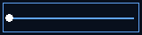
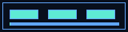
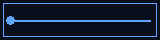

<!-- SatyTracker78 documentation | refreshed visual edition -->

<div align="center">

# SatyTracker78

### Record once. Review the flow. Repeat with control.

**A local-first workflow toolkit for authorized browser automation, with an optional Windows desktop companion and a workflow-management dashboard.**



[](https://github.com/SanFlash/satyenstg1/actions/workflows/ci.yml)
[](https://developer.chrome.com/docs/extensions/develop)
[](https://github.com/SanFlash/satyenstg1/releases/tag/desktop-helper-latest)
[](https://react.dev/)
[](https://www.typescriptlang.org/)

[Interactive experience](docs/interactive-guide/index.html) · [Quick start](#-quick-start) · [Architecture](#-how-the-parts-fit-together) · [Security](#-privacy-and-security) · [Troubleshooting](#-troubleshooting)

</div>

---

## A different view of every part

This documentation uses a **visual language matched to the job**: a system map for architecture, a waveform for recording, a state machine for replay, a permission dial for Windows, and a data journey for the dashboard. The diagrams are not interchangeable decorations; each explains a different mechanism.

> **[Launch the interactive GSAP experience →](docs/interactive-guide/index.html)**  
> A responsive, full-page product tour with 3D scene transitions, a replay simulator, interactive component views, and section-specific motion.

GitHub README pages do not execute embedded JavaScript, custom CSS, or GSAP timelines. The Markdown below therefore uses GitHub-compatible animated SVGs. The linked HTML guide is where GSAP, MotionPathPlugin, ScrollTrigger, pointer-responsive 3D and working interactions run.

---

## 01 / Product at a glance



SatyTracker78 consists of three related but distinct components:

| Component | What it does | Current status |
|---|---|---|
| **Chrome extension** | Captures supported browser DOM interactions and replays recorded sequences | Browser record-and-repeat experience |
| **Windows Desktop Helper** | Optional Native Messaging companion with a local permission gate | Windows 10/11 x64 companion; separate from browser replay |
| **Workflow dashboard** | Creates, edits, validates, imports/exports workflow definitions and reviews history | Local management UI; queue execution is safely blocked without an authenticated adapter |

**Important separation:** browser replay and the dashboard queue are different execution paths. A dashboard connection toggle is demonstrative UI state, not proof of live pairing. Queue attempts are recorded as blocked until a real authenticated local execution adapter exists.

---

## 02 / Capture — from interaction to useful context



The recorder focuses on supported DOM interactions rather than screen-video capture. It stores context that can help locate the target again:

- Best-effort selector and element attributes
- Visible text and accessible role
- Labels and nearby text
- Normalized position and interaction details

Sensitive password, file-upload, payment-card and one-time-code fields are excluded. Always review a recorded workflow before replaying it.

---

## 03 / Replay — resolve, validate, act, repeat


A replay cycle follows this sequence:

1. **Resolve** the saved selector and inspect the recorded context.
2. **Wait** for the target when the page is still rendering.
3. **Validate** the candidate against available text, role, label and nearby context.
4. **Move** the visible in-page cursor using eased motion.
5. **Dispatch** the supported synthetic page-level interaction.
6. **Pause and repeat** using the configured action and loop delays.
7. **Stop** manually or when stop-on-error is enabled.

**Technical boundary:** the animated pointer is rendered inside the page. Replay dispatches synthetic page-level pointer/mouse events; these are not trusted hardware events and do not move the physical operating-system cursor. Protected sites, canvas interfaces, cross-origin frames and applications requiring trusted input may reject these events or need specialized support.

---

## 04 / Windows companion — permission is a lifecycle


The optional helper is a self-contained **.NET 8 Windows x64** Native Messaging companion.

- Supports Windows 10/11 x64.
- Installs for the current Windows user.
- Registers the Native Messaging host for the exact extension ID supplied during setup.
- Requests local approval before desktop input is enabled.
- Permission expires after five minutes; Stop or Chrome disconnect revokes the session.
- Includes guided install, uninstall and diagnostic scripts.

The companion is independently installed. Its presence does **not** mean every browser replay step is routed through trusted operating-system input.

---

## 05 / Dashboard — manage definitions, not pretend execution


The React + Vite + TypeScript dashboard currently supports:

- Create, rename, edit and delete workflow definitions.
- Add steps and choose action types such as click, double-click, hover, scroll, wait and verify.
- Configure CSS, XPath, ID, text, role and test-ID locator strategies.
- Set timeout, retry, repeat count, delay and stop-on-error values.
- Import validated workflow JSON (1 MB file-size limit).
- Export workflow definitions and execution history as JSON.
- Persist definitions and history in the current browser's local storage.

**Execution status:** hosted dashboard queue attempts are recorded as `blocked` because no authenticated local execution adapter is connected. The dashboard is a workflow-management interface, not yet a production execution engine.

---

## 06 / Privacy and security boundaries


- Sensitive credential, payment and file-upload inputs are excluded from capture.
- The Windows helper requires explicit local approval and expires that permission.
- Stop controls remain available to the user.
- Use the extension only on sites, accounts and devices where you have authorization.
- The product does not spoof activity, bypass monitoring, or evade security controls.

---

## 07 / Build and release path


CI and release documentation: [Deployment guide](docs/DEPLOYMENT.md). Security notes: [Security guide](docs/SECURITY.md). System design: [Architecture guide](docs/ARCHITECTURE.md).

---

## 08 / Quick start

### Chrome extension

1. Clone the repository:
   ```bash
   git clone https://github.com/SanFlash/satyenstg1.git
   cd satyenstg1
   ```
2. Open `chrome://extensions` in Chrome.
3. Enable **Developer mode**.
4. Select **Load unpacked** and choose the `extension/` directory.
5. Open a website you are authorized to operate.
6. Open the SatyTracker78 popup and select **Start recording**.
7. Perform the task, then select **Finish recording**.
8. Review the steps and configure action/loop delays.
9. Select **Start repeating flow**. Reopen the popup and select **Stop replay** when finished.

### Optional Windows helper

Follow the [Windows installation guide](desktop-agent/README.md). Use only the package from a successful release, enter the exact extension ID during setup, and approve local permission only when required.

### Dashboard development

See the [deployment guide](docs/DEPLOYMENT.md) for the dashboard's development and deployment workflow.

---

## 09 / Documentation map

| Guide | Contents |
|---|---|
| [Interactive GSAP guide](docs/interactive-guide/index.html) | Animated product tour and replay simulator |
| [Architecture](docs/ARCHITECTURE.md) | Component boundaries and data flow |
| [Deployment](docs/DEPLOYMENT.md) | Build and deployment guidance |
| [Security](docs/SECURITY.md) | Sensitive-field exclusions and permission boundaries |
| [Tracker integrations](docs/tracker-integrations.md) | Research and current integration status |
| [Extension](extension/README.md) | Browser extension setup and behavior |
| [Desktop helper](desktop-agent/README.md) | Windows companion installation and diagnostics |
| [Native host](extension/native-host/README.md) | Native Messaging host details |

### Visual reference library

Each diagram has one clear job. Open the linked [interactive guide](docs/interactive-guide/index.html) for the complete motion-led presentation.

- [System overview](docs/assets/system-overview.svg) · [Recording pipeline](docs/assets/recording-pipeline.svg)
- [Replay state machine](docs/assets/replay-state-machine.svg) · [Desktop permission](docs/assets/desktop-permission.svg)
- [Dashboard lifecycle](docs/assets/dashboard-lifecycle.svg) · [Security boundaries](docs/assets/security-boundaries.svg)
- [CI and release flow](docs/assets/ci-release-flow.svg) · [Workflow lifecycle](docs/assets/workflow-lifecycle.svg)

---

## Compatibility and honest limitations

- Browser replay relies on synthetic page-level events, not trusted hardware input.
- Canvas-heavy, protected, cross-origin and highly dynamic websites may not replay reliably.
- Sensitive password, file-upload, payment-card and one-time-code fields are excluded.
- The optional Windows helper is a separate component; end-to-end trusted desktop replay is not claimed.
- The dashboard does not currently execute workflows through an authenticated local adapter.
- Adapters for Upwork, TeamLogger, Time Doctor, Hubstaff, DeskTime, Toggl Track and Clockify are **not implemented**.

## Troubleshooting

1. **Extension does not appear:** verify Developer mode and that the selected unpacked folder is `extension/`.
2. **Replay cannot find a target:** confirm the page is fully loaded and that the element is still present and accessible.
3. **A website ignores a replay action:** it may require trusted physical input or use a protected/canvas-based interface.
4. **Native host connection fails:** check the extension ID entered during setup, host registration and Chrome restart; consult [desktop diagnostics](desktop-agent/README.md).
5. **Dashboard queue says blocked:** this is the expected current behavior until an authenticated local execution adapter is implemented.

---

<div align="center">

### Explore the system. Understand the boundaries. Automate with control.

[Open the interactive GSAP walkthrough](docs/interactive-guide/index.html) · [Browse the source](https://github.com/SanFlash/satyenstg1)

**SatyTracker78** · Created by Satyendra Kumar Namdeo

</div>
