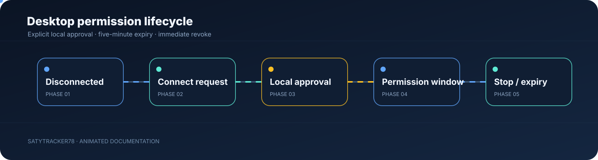
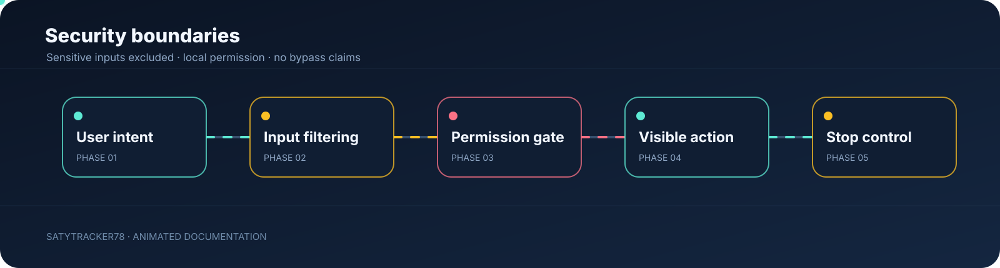
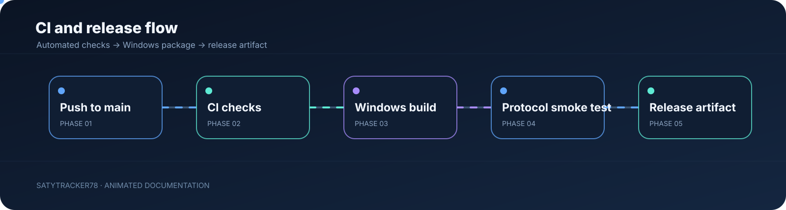

# SatyTracker78 Windows Desktop Helper

> **Visual documentation:** each section uses a purpose-built diagram for its subject. For animated 3D scenes and interactive controls, open the [GSAP Motion Lab](../docs/interactive-guide/index.html). GitHub README Markdown cannot run embedded GSAP or custom JavaScript.

End-user Windows x64 companion for the SatyTracker78 Chrome extension.

## Install (no developer tools required)

1. Download and extract **SatyTracker78-Windows-Setup.zip** from the latest GitHub Release.
2. Double-click **Setup-SatyTracker78.cmd**.
3. When prompted, paste the extension ID shown at chrome://extensions.
4. The installer copies the self-contained helper into the user's LocalAppData SatyTracker78 folder, writes and validates the Native Messaging manifest, and registers it for the current Windows user.
5. Fully exit and reopen Chrome, reload SatyTracker78, and click **Connect & enable desktop helper**.
6. Approve the Windows permission dialog only when you intend to allow visible desktop input.

No separate .NET SDK, Python, pip, administrator access, or manual registry editing is required. The installer is per-user and only registers the exact extension ID entered.

## Uninstall

Run **Uninstall-SatyTracker78.cmd** from the extracted setup folder. It removes the current user's native messaging registration and installed SatyTracker78 folder, including its local log.

## Troubleshooting

- Confirm the extension ID pasted during setup matches the ID shown at chrome://extensions.
- Restart all Chrome processes after installation.
- Re-run Setup-SatyTracker78.cmd to repair the helper registration.
- The log is stored under LocalAppData\SatyTracker78\native-host.log.

## Security

Desktop input is disabled until the user approves a local Windows permission dialog. Permission expires after five minutes; Stop or Chrome disconnect revokes it. The helper performs bounded, explicit input actions only. It does not capture screenshots, clipboard contents, passwords, keystrokes, hidden activity, spoof idle/productivity signals, or bypass tracker controls.

## Developer build

The source project remains in this directory. For development, use the .NET 8 SDK and build-and-install.bat. End users should use the self-contained Windows setup ZIP instead.

## Animated desktop-helper flow

The sequence shows the actual documented permission boundary: the helper is installed for the current Windows user, Chrome connects through Native Messaging, and desktop input remains disabled until the local Windows permission dialog is approved. Permission expires after five minutes; Stop or Chrome disconnect revokes it.

The diagrams are documentation visuals, not a live permission monitor. See the [full GSAP product guide](../docs/interactive-guide/index.html) and [repository README](../README.md) for the complete product walkthrough.
