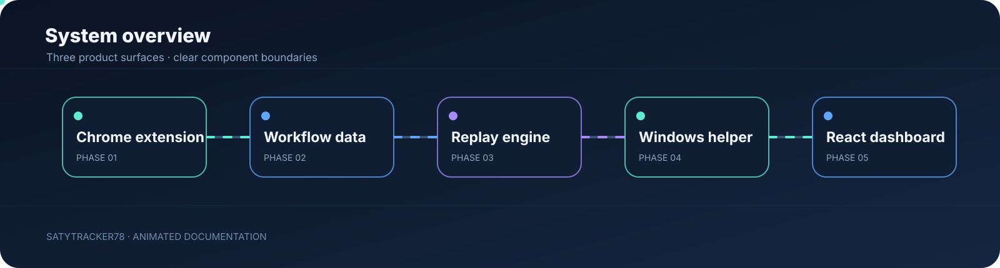

# Architecture

Vercel serves the static React/Vite dashboard. The Chrome extension is installed in the user's browser. A native messaging host validates extension origin and messages. A separately installed desktop agent performs explicitly permitted OS interactions.

Browser and desktop adapters remain separate. Browser adapter validates origin, locator match count and target state. Desktop adapter is permission-scoped and has an independent emergency stop.

Execution states: draft, validated, scheduled, queued, running, paused, completed, failed and cancelled. The hosted UI currently records queue intent only; it does not execute actions.

Long-running jobs belong in the local agent or a separately deployed persistent worker, not a Vercel serverless function.

## Native Messaging request lifecycle

The Manifest V3 service worker is the sole owner of the Chrome Native Messaging port. It correlates each request with a unique request ID, resolves the caller only after the helper returns a matching response, and rejects pending work on timeout or port disconnect. Popup components must use the service worker message API; they must never open their own native host connection.

The desktop permission flow remains independent from browser replay:
1. Request the native host status.
2. Ask the user to approve the local Windows permission prompt.
3. Permit explicit, bounded actions only while the permission window remains active.
4. Display the result returned by the host; a successful message send alone is not proof that an action executed.
5. On Stop, revoke permission and close the port. On host disconnect, reject pending calls and show the disconnected state.

The React dashboard is a workflow-definition and audit interface only. It must not show a live-connected state unless a real, authenticated extension-to-dashboard pairing handshake is implemented. Its queue action remains blocked rather than simulating a successful desktop run.
