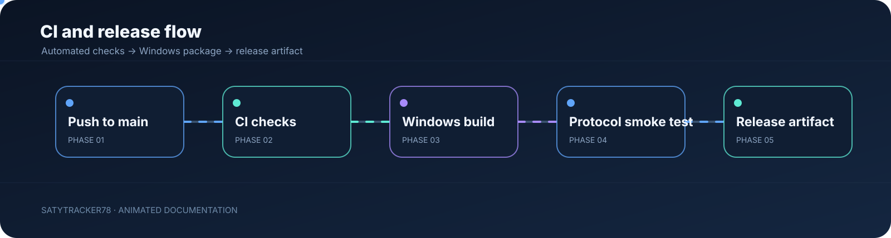

# Deployment

## Vercel
Framework Vite; install npm install; build npm run build; output dist. No environment variables are required. Client-side SPA; workflow data is in browser localStorage.

Do not implement local mouse control in Vercel serverless routes. Package the local agent separately for each supported OS and register the Chrome Native Messaging manifest during installation.
