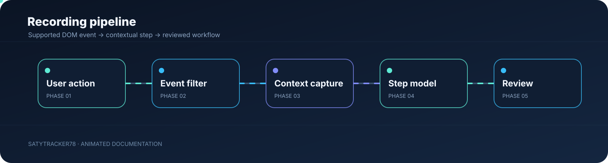
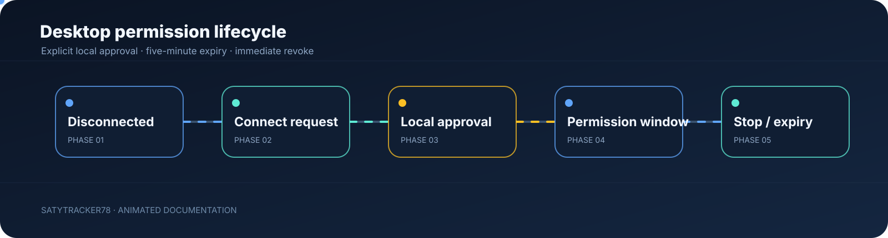
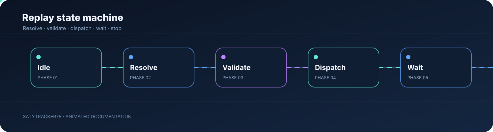
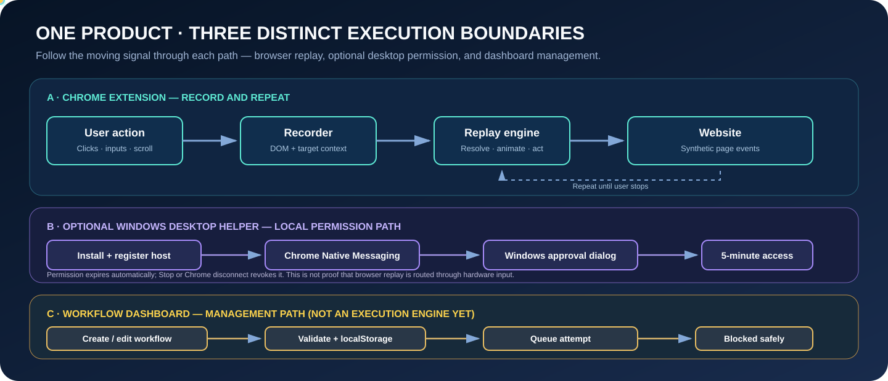

# SatyTracker78 Chrome extension

Created by **Satyendra Kumar Namdeo**.

## Install / update

1. Open `chrome://extensions` and enable Developer mode.
2. Choose **Load unpacked** and select this repository's `extension` folder.
3. Click **Reload** on SatyTracker78 and refresh the target website.

## Optional Windows desktop agent

Download the latest successful `satytracker78-windows-agent-source` artifact from [GitHub Actions](https://github.com/SanFlash/satyenstg1/actions), extract it, and run `build-and-install.bat`. Paste the extension ID from `chrome://extensions` when prompted, restart Chrome, reload the extension, and approve the local permission prompt when you intend to use desktop input. Run `diagnose-agent.ps1` if it does not connect. The old Python installer is deprecated; see [desktop-agent documentation](../desktop-agent/README.md).

## Use

1. Open a normal `http://` or `https://` website.
2. Open the SatyTracker78 toolbar popup and click **Start recording**.
3. Perform the task, reopen the popup and click **Finish recording**.
4. Choose **Flow speed** to set the delay between actions and **Delay between loops** to set the pause between complete cycles.
5. Click **Start repeating flow**. Replay continues until you reopen the popup and click **Stop replay**.

## Background operation and input model

All controls live in the extension popup. During replay, a small arrow cursor is animated inside the webpage with curved Bézier trajectories, distance-based acceleration, smooth frame-by-frame motion, hover transitions, a short target pause, press feedback and a click ripple. No floating control panel, Chrome debugger attachment or debugger permission is used, so Chrome's "started debugging this browser" banner is not triggered.

New recordings save visible text, accessible role, labels, attributes, nearby text context and normalized position in addition to a best-effort selector. Replay tries the selector, then semantic/context matching, then a position fallback.

Clicks use synthetic page-level pointer and mouse events coordinated with the animated page cursor. These avoid the debugger banner but are **not trusted hardware input** and do not move the operating-system cursor. Some websites may reject synthetic events or require trusted physical input; a native desktop helper would be needed for that. Protected pages, canvas interfaces and cross-origin frames need specialized support.

The extension records DOM actions, not a screen video. Password, file-upload, payment-card and one-time-code fields are excluded. Use only on sites you are authorized to operate. Do not automate purchases, bulk messaging, destructive actions, CAPTCHA or access-control bypasses.

## Animated browser workflow

The recorder captures supported DOM interactions and stores target context for later matching. Sensitive password, file-upload, payment-card and one-time-code fields are excluded.

Replay attempts target resolution and validation before dispatching synthetic page-level events. The in-page cursor is a visual aid; it does not move the operating-system pointer or create trusted hardware input. Protected sites, canvas interfaces, cross-origin frames and pages requiring trusted input may reject these events.

For the interactive GSAP walkthrough, open the [product guide](../docs/interactive-guide/index.html). For the full visual library and project boundaries, see the [root README](../README.md).
